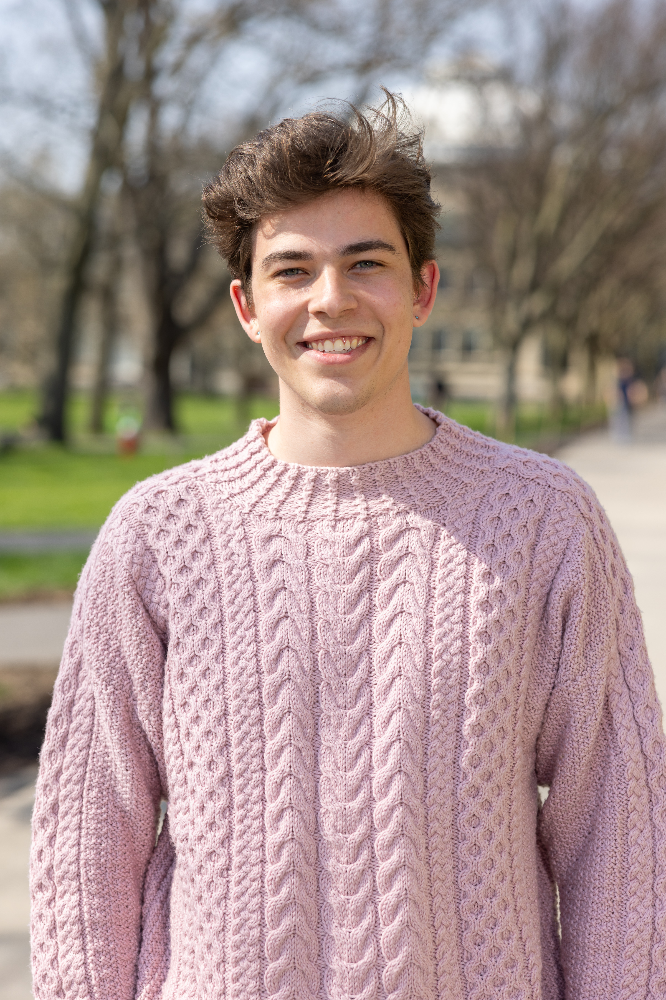

I am a third-year PhD student in the [UT Austin Computational Linguistics Group](https://sites.utexas.edu/compling/). I am fortunate to be advised by [Kyle Mahowald](https://mahowak.github.io/). I work on **interpretability**, with a focus on what the study of language model internals can tell us more broadly about language and cognition.

Previously, I graduated from Cornell University Summa Cum Laude, with degrees in [Computer Science](https://www.cs.cornell.edu/), [Mathematics](https://math.cornell.edu/), and Computational Cognitive Science (the latter through the [College Scholar Program](https://as.cornell.edu/education/college-scholar-program)). During my undergraduate studies, I was fortunate enough to work with [Dr. Morten H. Christiansen](https://psychology.cornell.edu/morten-h-christiansen) and [Dr. Eugene Vinitsky](https://www.eugenevinitsky.com/) utilizing Multi-Agent Reinforcement Learning to study idiolects in human language. I have also spent time at NASA's Jet Propulsion Laboratories working on Retrieval-Augmented Generation (RAG) systems.

## News

<ul class="news-list">
<li class="news-item">Nov 2026<a href="https://arxiv.org/abs/2608.28924">Causal Interventions Reveal Typologically Organized Syntactic Mechanisms in Multilingual Language Models</a> accepted to EACL 2027. See you in Athens 🇬🇷!</li>
<li class="news-item">Oct 2026Causal Interventions Provide Evidence of Cross-Lingual Representation Convergence in Language Models accepted as an Oral at LSA 2027. See you in San Francisco 🇺🇸!</li>
<li class="news-item">Sep 2026<a href="https://openreview.net/forum?id=pXYWXZE3QV">Parasite Features: Causal Abstraction Through Spurious Pathways</a> accepted to NeurIPS 2026. See you in Paris 🇫🇷!</li>
<li class="news-item">Jul 2026<a href="http://arxiv.org/abs/2604.13950">Causal Drawbridges: Characterizing Gradient Blocking of Syntactic Islands in Transformer LMs</a> accepted to COLM 2026. See you in San Francisco 🇺🇸!</li>
<li class="news-item">Apr 2026<a href="https://arxiv.org/abs/2602.23547">France or Spain or Germany or France: A Neural Account of Non-Redundant Redundant Disjunctions</a> accepted to CogSci 2026. See you in Rio 🇧🇷!</li>
<li class="news-item">Nov 2025🏆 <a href="https://aclanthology.org/2025.emnlp-main.1271">Causal Interventions Reveal Shared Structure Across English Filler–Gap Constructions</a> awarded Outstanding Paper at EMNLP 2025!</li>
<li class="news-item">Aug 2025<a href="https://aclanthology.org/2025.emnlp-main.1271">Causal Interventions Reveal Shared Structure Across English Filler–Gap Constructions</a> accepted to EMNLP 2025 as Oral Spotlight. See you in Suzhou 🇨🇳!</li>
<li class="news-item">Apr 2025<a href="https://escholarship.org/uc/item/5c03t5fp">Reinforcement learning produces efficient case-marking systems</a> accepted to CogSci 2025</li>
<li class="news-item">Oct 2024<a href="https://arxiv.org/abs/2409.17005">Models Can and Should Embrace the Communicative Nature of Human-Generated Math</a> accepted to 4th MATH-AI Workshop at NeurIPS'24. See you in Vancouver!</li>
<li class="news-item">Aug 2024Started PhD at UT Austin</li>
<li class="news-item">May 2024Graduated Cornell!</li>
<li class="news-item">May 2024Defended thesis, awarded Summa Cum Laude Honors</li>
</ul>

## Education

- **PhD, Computational Linguistics** (Minor: Philosophy), *University of Texas at Austin*, 2024&ndash;2029
- **BA, Computer Science, Mathematics, and Computational Cognitive Science** (Summa Cum Laude), *Cornell University*, 2020&ndash;2024

## Selected Papers

1. 🏆 **Sasha Boguraev**, Christopher Potts, Kyle Mahowald. [Causal Interventions Reveal Shared Structure Across English Filler–Gap Constructions](https://aclanthology.org/2025.emnlp-main.1271) *EMNLP 2025 Outstanding Paper Award, Oral Spotlight.*

2. **Sasha Boguraev**, Kyle Mahowald. [Causal Drawbridges: Characterizing Gradient Blocking of Syntactic Islands in Transformer LMs](http://arxiv.org/abs/2604.13950) *COLM 2026.*

3. **Sasha Boguraev**, Toshiki Nakai, Kyle Mahowald, Julius Steuer. [Causal Interventions Reveal Typologically Organized Syntactic Mechanisms in Multilingual Language Models](https://arxiv.org/abs/2608.28924) *EACL 2027.*

4. **Sasha Boguraev**, Qing Yao, Kyle Mahowald. [France or Spain or Germany or France: A Neural Account of Non-Redundant Redundant Disjunctions](https://arxiv.org/abs/2602.23547) *CogSci 2026.*

## In the Media

I was named one of the Cornell Arts and Sciences Extraordinary Seniors, and had a brief [profile](https://math.cornell.edu/news/i-studied-why-miscommunication-and-ambiguity-are-so-prevalent-human-language) written on my time at Cornell.

## Elsewhere

- [Publications](/publications/)
- [CV](/cv/)
- [Email](mailto:sasha.boguraev@utexas.edu)
- [GitHub](https://github.com/SashaBoguraev)
- [Google Scholar](https://scholar.google.com/citations?authuser=1&user=iUKlzyQAAAAJ)
- [UT Austin Computational Linguistics Group](https://sites.utexas.edu/compling/)
